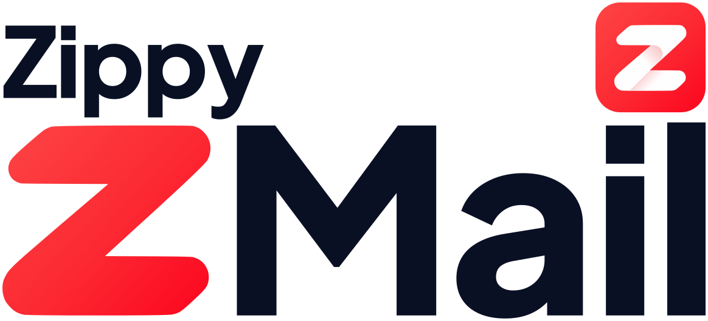
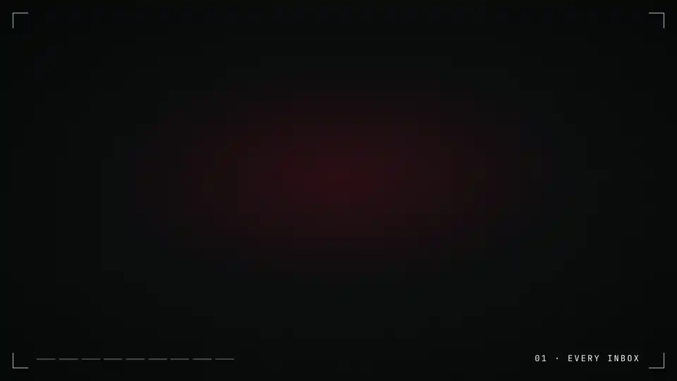

<p align="center">
  <picture>
    <source media="(prefers-color-scheme: dark)" srcset="Brand/readme/hero-dark.svg">
    <source media="(prefers-color-scheme: light)" srcset="Brand/readme/hero-light.svg">
    
  </picture>
</p>

<h3 align="center">Your inbox, on autopilot.</h3>

<p align="center">
  AI sorts, answers and attaches for you, around the clock. Your time is worth more than your inbox.<br>100% free, 100% open source, 100% AI-powered.
</p>

<p align="center">
  <a href="https://github.com/AdamPomposelli/ZMail/releases/latest"></a>
  
  
  <a href="LICENSE"></a>
  
  <br>
  <a href="https://TODO-zippy-website"></a>
  <a href="https://TODO-zsquad"></a>
  <a href="https://TODO-x"></a>
  <a href="https://github.com/AdamPomposelli/ZMail/stargazers"></a>
</p>

<p align="center">
  <a href="https://github.com/AdamPomposelli/ZMail/releases/latest/download/ZMail.dmg">
    
  </a>
  <br>
  <sub>No account · No subscription · <a href="#quick-start">Ready in 3 minutes</a></sub>
  <br>
  <sub>Built with ❤︎ by the <a href="https://TODO-zippy-website">Zippy</a> team</sub>
</p>

<p align="center">
  <a href="#quick-start">Quick start</a> |
  <a href="#everything-it-does">Features</a> |
  <a href="#privacy">Privacy</a> |
  <a href="#make-it-yours">Make it yours</a> |
  <a href="#contributing">Contributing</a> |
  <a href="https://TODO-zsquad">ZSquad</a>
</p>

<!-- Made with HyperFrames; source and re-render steps in Brand/demo/. -->
<p align="center">
  
</p>

## ❤️ Why ZMail

Stop watching your inboxes. Get the hours back and spend them on real work.

<table>
  <tr>
    <td align="center" width="72"><h3>💸</h3></td>
    <td><b>Free. Really.</b><br>No subscription, no seat, no account. The AI runs on your Mac with Apple Intelligence, so sorting your mail costs nothing, today and every day after.</td>
  </tr>
  <tr>
    <td align="center"><h3>🔒</h3></td>
    <td><b>Your mail stays yours.</b><br>ZMail talks straight to your mail servers. Messages, passwords and keys live on your Mac, encrypted. There is no ZMail server to send them to.</td>
  </tr>
  <tr>
    <td align="center"><h3>🧠</h3></td>
    <td><b>Hours back, every day.</b><br>AI watches every inbox 24/7: each new mail is tagged, prioritised and summarised the moment it lands. Spam is out of the way, codes are one click from your clipboard, opportunities stand out.</td>
  </tr>
</table>

> [!NOTE]
> **Built by people with too many inboxes.** We run several businesses across Gmail, iCloud and our own servers, and read all of it in ZMail. If something gets in the way, we feel it first.

<a id="quick-start"></a>

## ⏱️ Quick start

From download to a sorted inbox in **under 3 minutes**.

| | Step | ⏱ |
|:-:|---|:-:|
| **1** | ⬇️ **[Download ZMail.dmg](https://github.com/AdamPomposelli/ZMail/releases/latest/download/ZMail.dmg)**, open it, and drag ZMail onto Applications. | 20 s |
| **2** | 🔓 **Open ZMail.** macOS blocks the first launch: go to *System Settings → Privacy & Security* and click **Open Anyway**. | 20 s |
| **3** | 📬 **Connect your first inbox.** Pick your provider (Gmail, iCloud, Outlook, Fastmail, mailbox.org, your own server…) and paste an app password. ZMail tests it before saving. | 60 s |
| **4** | ➕ **Add the others.** Every account lands in the same unified inbox. | 60 s |
| **5** | ✨ **Open your inbox.** New mail is already sorted, tagged and summarised. | <b>0&nbsp;s&nbsp;⚡</b> |

> [!TIP]
> **Not on macOS 26 yet?** On-device AI needs it. In *Settings → AI*, paste a key from ZenMux, OpenRouter, OpenAI, or point ZMail at Ollama. Without any AI, a built-in heuristic engine keeps the inbox sorted.

> [!IMPORTANT]
> Step 2 is there because ZMail isn't notarised by Apple yet. You do it once.

## 🗂️ One inbox, every business

Run more than one thing? ZMail files each mail under the business it belongs to, from the account, alias or domain it was sent to.

| | View | What you see |
|:-:|---|---|
| 📥 | **Unified inbox** | Every account, sorted by priority then date. |
| 🏢 | **By business** | Only the mail of one activity, with its own unread count. |
| 🔥 | **Important** | What the AI flagged as needing you today. |
| 💼 | **Opportunities** | Leads, partnerships and deals, pulled out of the noise. |

<a id="everything-it-does"></a>

## ✨ Everything it does

<table>
  <tr>
    <td width="50%" valign="top">📥 <b>All your inboxes, one list</b><br>Gmail, iCloud, Outlook, Fastmail, Zoho, mailbox.org, Namecheap or your own IMAP server. Mail arrives in real time.</td>
    <td width="50%" valign="top">🏷️ <b>Sorted before you look</b><br>Tags, priority and a one-line summary on every new mail, with your own tags on top of the built-in ones.</td>
  </tr>
  <tr>
    <td valign="top">🔑 <b>Codes, one click away</b><br>A login code arrives, a notification shows it with a <i>Copy code</i> button. No need to open the mail.</td>
    <td valign="top">🧹 <b>Unsubscribe for real</b><br>One click and ZMail does the unsubscribing for you, link, mail or web form. If it fails, you're told.</td>
  </tr>
  <tr>
    <td valign="top">🔁 <b>It learns your habits</b><br>Archive the same sender three times and ZMail offers to make it a rule. One click to accept.</td>
    <td valign="top">💬 <b>Just ask</b><br>Tell the assistant <i>"notify me about every chargeback"</i> and the rule is written for you.</td>
  </tr>
  <tr>
    <td valign="top">✍️ <b>Replies that sound like you</b><br>The compose assistant drafts, shortens or rewrites, and your signature follows the account you send from.</td>
    <td valign="top">🔔 <b>Only the pings that matter</b><br>Codes, urgent mail, opportunities and your own rules. Everything else waits quietly.</td>
  </tr>
  <tr>
    <td valign="top">📎 <b>Your files, found for you</b><br>Say <i>"reply to Sophie and attach the March invoice"</i>: the assistant writes the reply, finds the file on your Mac and attaches it.</td>
    <td valign="top">🎙️ <b>Talk instead of type</b><br>Dictate what the mail should say and who it goes to. The assistant fills in every field, ready to review.</td>
  </tr>
  <tr>
    <td valign="top">🔎 <b>Find anything, instantly</b><br>Full-text search across every account, on your Mac, even offline.</td>
    <td valign="top">🎚️ <b>Pick your precision</b><br><b>Free</b>, <b>Business</b> or <b>Ultra</b>: one click sets how hard the AI works, from free models to two AIs checking every mail. ZMail shows what it costs on your real volume.</td>
  </tr>
  <tr>
    <td valign="top">🤖 <b>Run it from your AI</b><br>Manage your mail from Claude, ChatGPT or any MCP client: <i>"archive this week's newsletters"</i>, done. A local API is there for your own scripts.</td>
    <td valign="top">🎨 <b>40+ themes</b><br>Light, dark and everything in between. Make ZMail look the way you like it.</td>
  </tr>
  <tr>
    <td valign="top">🧩 <b>Bring your own AI</b><br>Apple Intelligence on your Mac for free, or a key from ZenMux, OpenRouter, OpenAI, or a model on your machine with Ollama.</td>
    <td valign="top">📱 <b>Mobile, coming soon</b><br>The same inbox on your phone is on its way. Star the repo to hear about it first.</td>
  </tr>
</table>

<a id="privacy"></a>

## 🔒 Privacy

- 🏠 **Local-first:** your mail, search index and rules live in `~/Library/Application Support/ZMail`, on your Mac.
- 🔐 **Encrypted secrets:** mail passwords and API keys are encrypted with AES-256, the key kept in the macOS Keychain.
- 🧠 **On-device AI by default:** with Apple Intelligence, no mail ever leaves your Mac to be sorted.
- ☁️ **With a provider:** only the mail being processed goes to the provider you chose, with your own key, and nowhere else.
- 🚫 **No account, no telemetry, no analytics.** There is no ZMail server.

<a id="make-it-yours"></a>

## 🛠️ Make it yours

<details>
<summary>📏 <b>Write your own rules</b></summary>

<br>

In *Settings → Rules*, any rule ZMail proposed is yours to edit, and you can write new ones: match a sender, a business, a tag or a word, then archive, tag, notify or move. Every action you take is logged in *Settings → Activity*, which is where ZMail spots the habits it suggests turning into rules.

</details>

<details>
<summary>🦙 <b>Sort your mail with a local model (Ollama)</b></summary>

<br>

In *Settings → AI*, add an Ollama connection pointing at `http://localhost:11434`, then choose a model for each task: tagging, summaries, replies. ZMail benchmarks the models it knows and shows the results in [`docs/benchmarks`](docs/benchmarks/RESULTS.md).

</details>

<details>
<summary>🧑‍💻 <b>Build from source</b></summary>

<br>

You need macOS 26, the Xcode command-line tools, Node 22 or later and pnpm.

```bash
pnpm install      # dependencies
pnpm test         # engine tests
pnpm typecheck    # engine and UI types
pnpm build:app    # dist/ZMail.app, with the engine, the UI and Node inside
```

To work on the UI against demo mailboxes:

```bash
pnpm testmail:up                                            # local IMAP/SMTP server (Docker)
pnpm --filter @zmail/engine exec tsx scripts/demo.ts        # the engine, with seeded accounts
pnpm dev:ui                                                 # http://localhost:5317
```

| | |
|---|---|
| **`apps/macos/`** · Swift | The app: window, notifications, Keychain, Apple on-device AI, and the Zippy menu bar. |
| **`apps/server/`** · TypeScript | The engine: IMAP/SMTP, SQLite, the AI pipeline, rules, the MCP server. |
| **`apps/mail/`** · TypeScript + React | The interface. |
| **`testing/`** | A local mail server for tests and demos. |
| **`Brand/`** | Logo, variants and README assets. See [`Brand/BRAND.md`](Brand/BRAND.md). |

`pnpm build:app` signs with a local identity, or ad hoc. Notarising needs an Apple Developer account.

</details>

<a id="contributing"></a>

## 🤝 Contributing

ZMail gets better every time someone tells us what got in their way. No contribution is too small.

- 🐛 **Something broke?** [Open an issue](https://github.com/AdamPomposelli/ZMail/issues/new) and tell us what you expected.
- 💡 **Got an idea?** Pitch it in an [issue](https://github.com/AdamPomposelli/ZMail/issues) or on the [ZSquad](https://TODO-zsquad).
- 🌱 **First pull request?** Start with a [good first issue](https://github.com/AdamPomposelli/ZMail/labels/good%20first%20issue).
- 🛠️ **Ready to code?** Fork, branch, run `pnpm test` and `pnpm typecheck`, and open a pull request. [`AGENT.md`](AGENT.md) has the house rules.

## ⭐ Like it? Star it

A star takes one second and helps the next person find ZMail.

<p align="center">
  <a href="https://star-history.com/#AdamPomposelli/ZMail&Date">
    <picture>
      <source media="(prefers-color-scheme: dark)" srcset="https://api.star-history.com/svg?repos=AdamPomposelli/ZMail&type=Date&theme=dark">
      <source media="(prefers-color-scheme: light)" srcset="https://api.star-history.com/svg?repos=AdamPomposelli/ZMail&type=Date">
      
    </picture>
  </a>
</p>

<!--
  Contributors: uncomment once people outside the Zippy team have contributed.
  A wall of one face says "nobody uses this"; a wall of many says the opposite.

## ❤️ Made by

ZMail exists thanks to everyone who [contributed](#contributing).

<p align="center">
  <a href="https://github.com/AdamPomposelli/ZMail/graphs/contributors">
    
  </a>
</p>
-->

## 📄 Licence

**MIT.** Take it, change it, ship it, sell it, do whatever you want with it! See [LICENSE](LICENSE).
